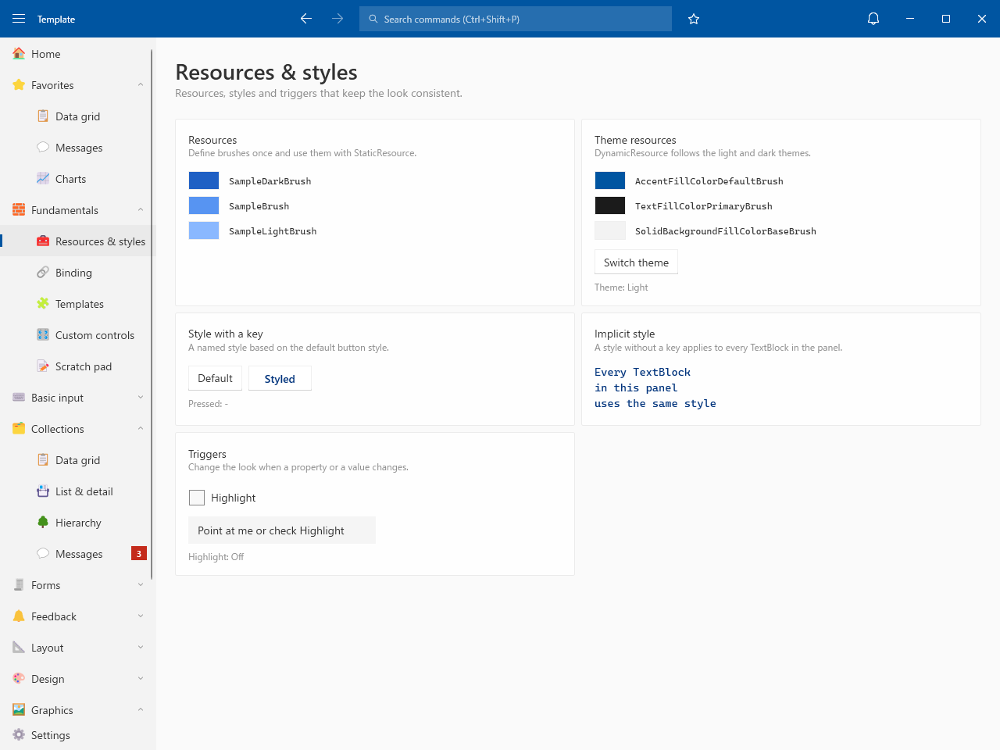
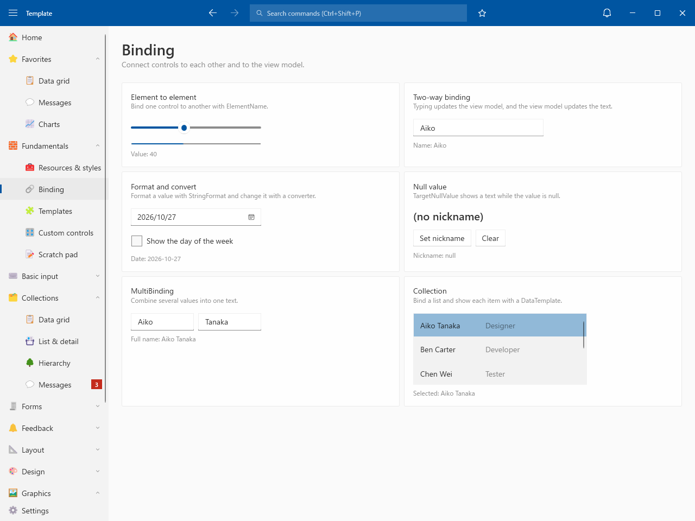
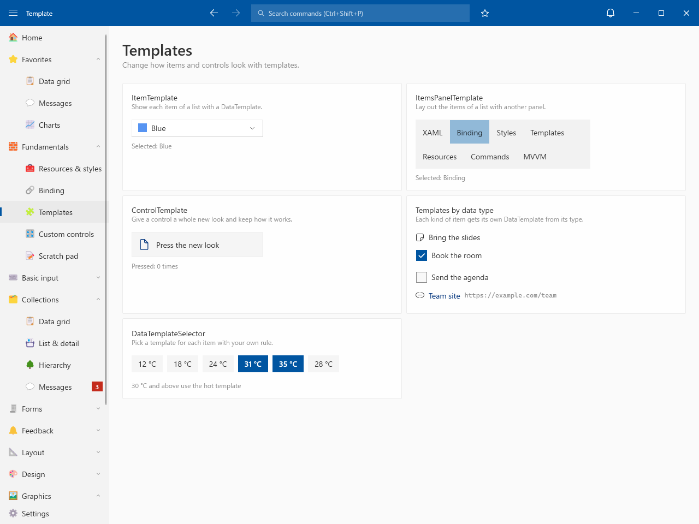
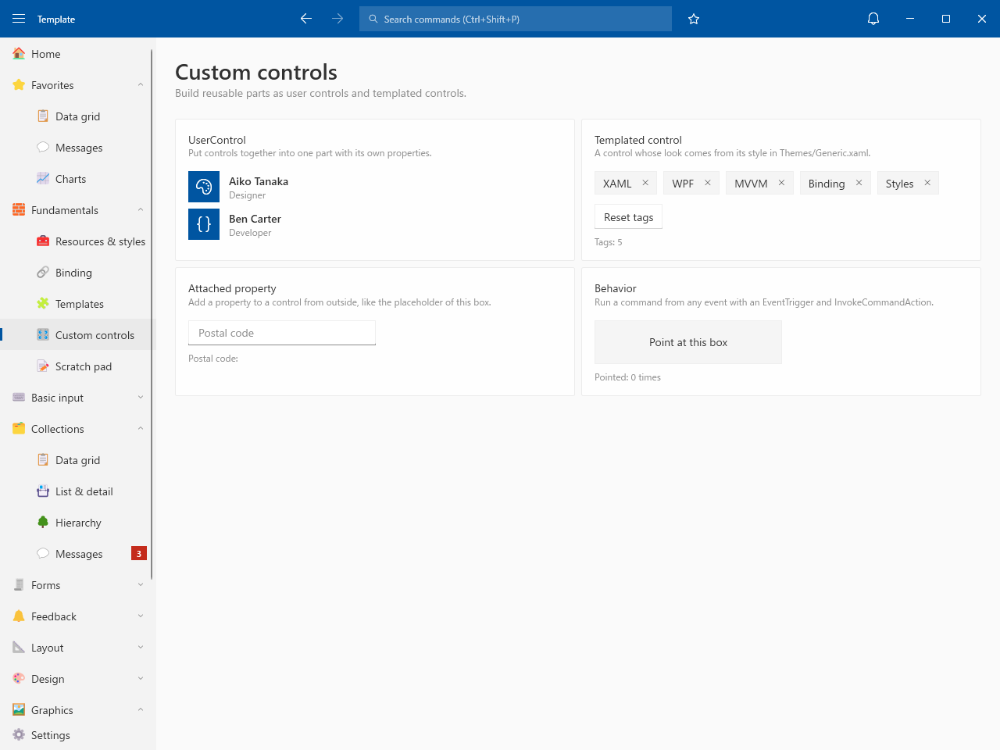
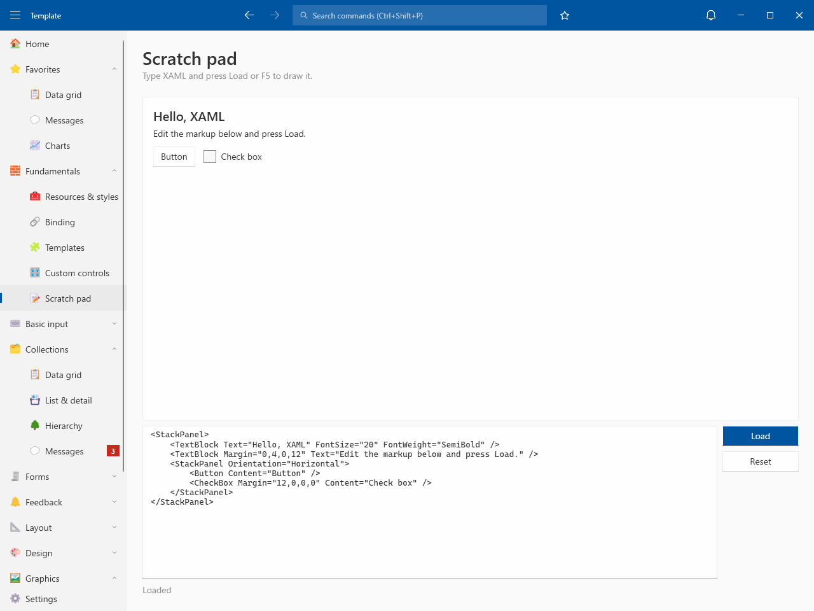

# Fundamentals

## Resources & styles

- Resources / Theme resources (light and dark) / Style with a key / Implicit style / Triggers

## Binding

- Element to element / Two-way binding / Format and convert / Null value / MultiBinding / Collection

## Templates

- ItemTemplate / ItemsPanelTemplate / ControlTemplate / Templates by data type / DataTemplateSelector

## Custom controls

- UserControl / Templated control / Attached property / Behavior

## Scratch pad

- Type XAML and draw it with Load or F5
- Parse errors are shown, and the last drawing stays
