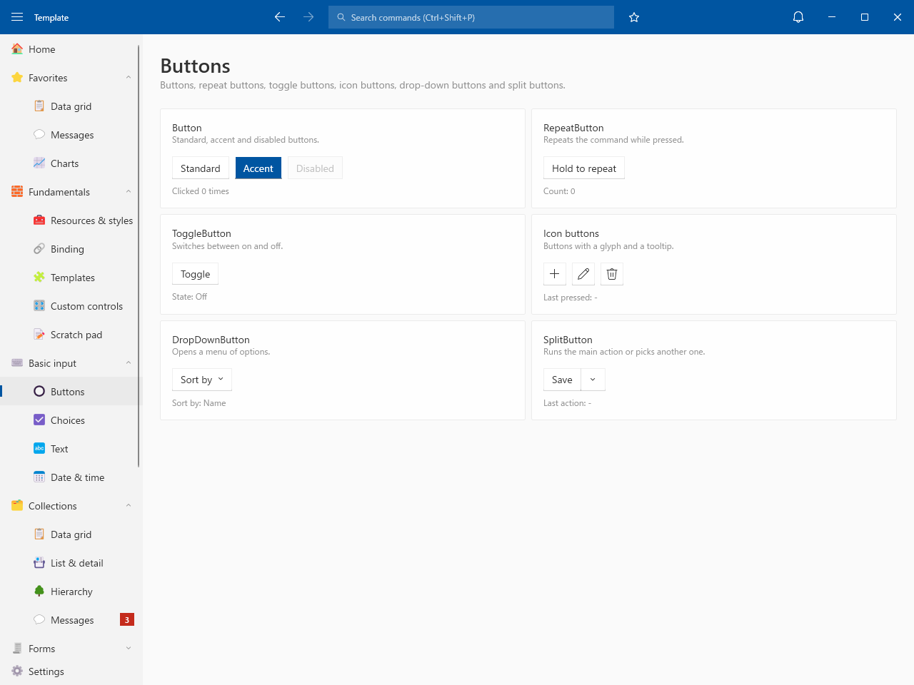
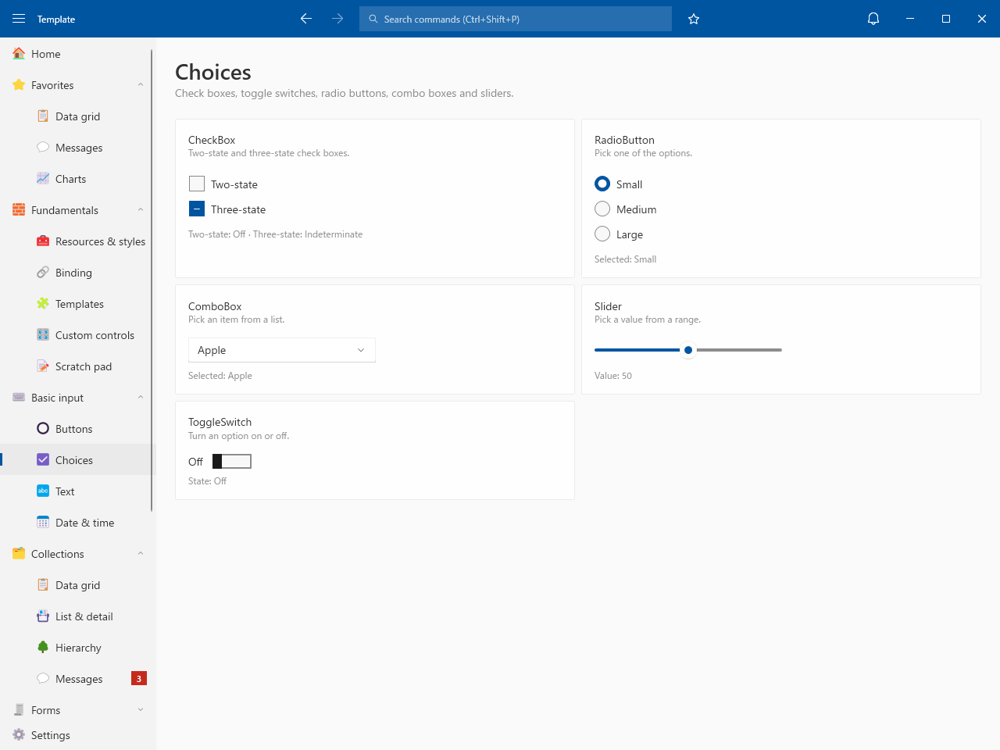
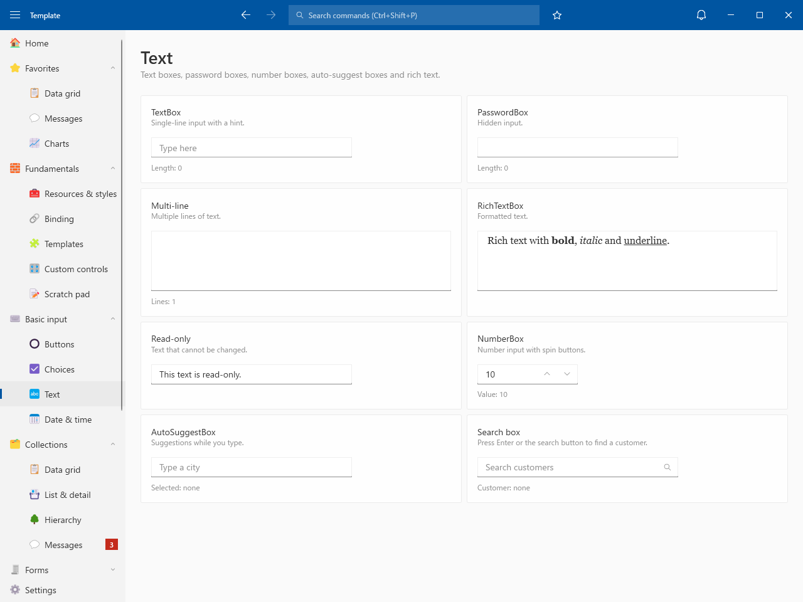
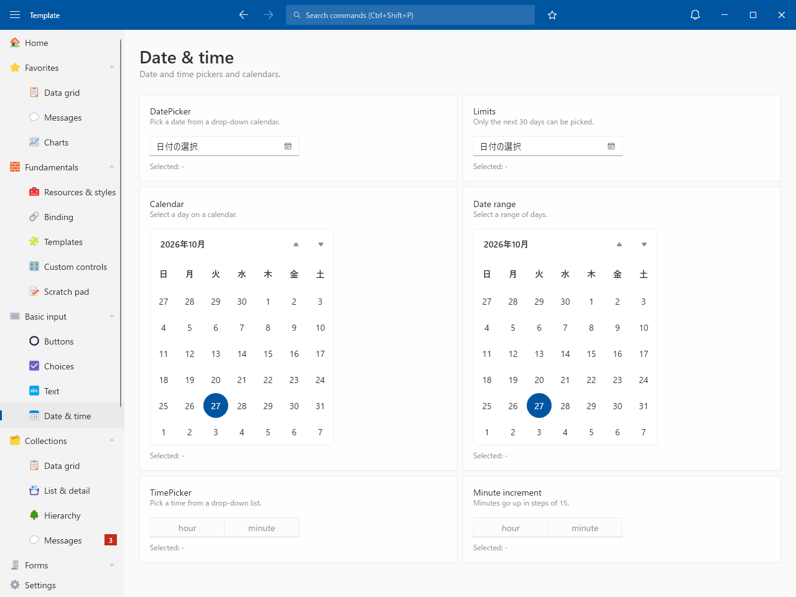

# Basic input

## Buttons

- Button / RepeatButton / ToggleButton / Icon buttons / DropDownButton / SplitButton

## Choices

- CheckBox / RadioButton / ComboBox / Slider / ToggleSwitch

## Text

- TextBox (placeholder) / PasswordBox / Multi-line / RichTextBox / Read-only / NumberBox
- AutoSuggestBox / Search box

## Date & time

- DatePicker / Limits / Calendar / Date range / TimePicker / Minute increment
