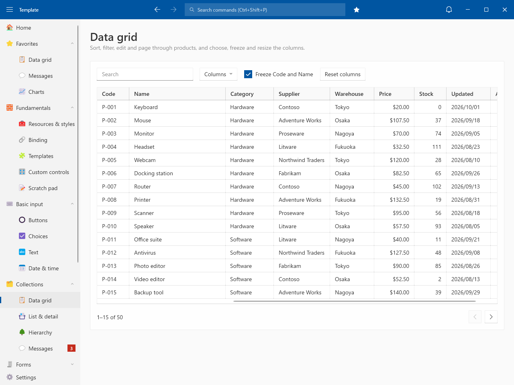
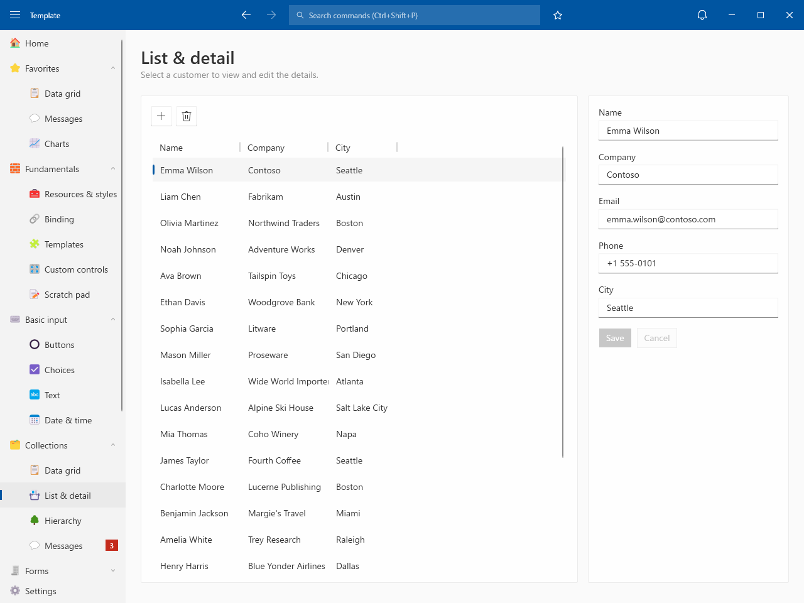
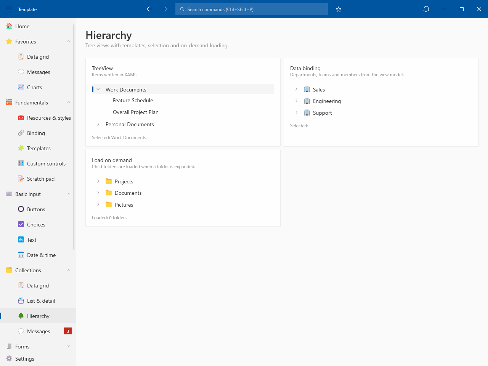
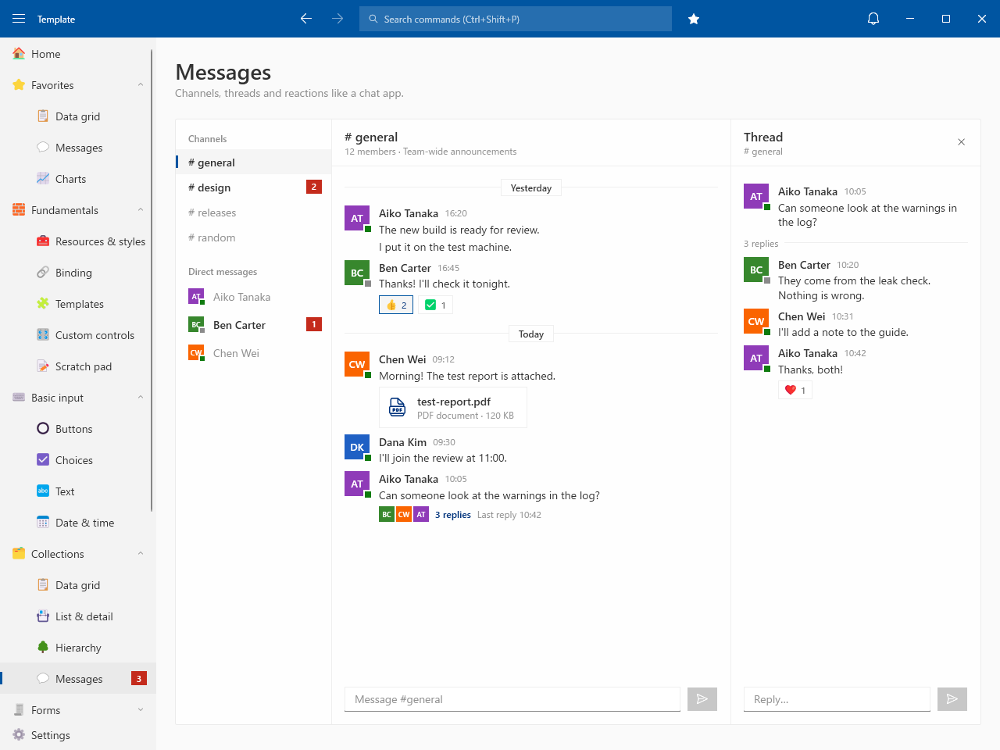

# Collections

## Data grid

- Search, sort and paging in SQLite
- Column chooser / Frozen columns / Saved column widths
- Edit cells and save each row

## List & detail

- Customers in SQLite
- Add / Save / Delete with a confirmation

## Hierarchy

- TreeView / Data binding / Load on demand

## Messages

- Channels and direct messages with unread counts
- Threads and reactions
