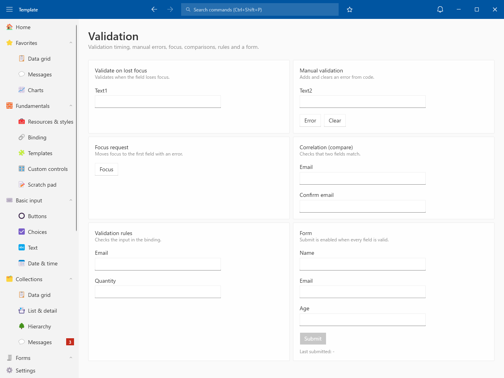
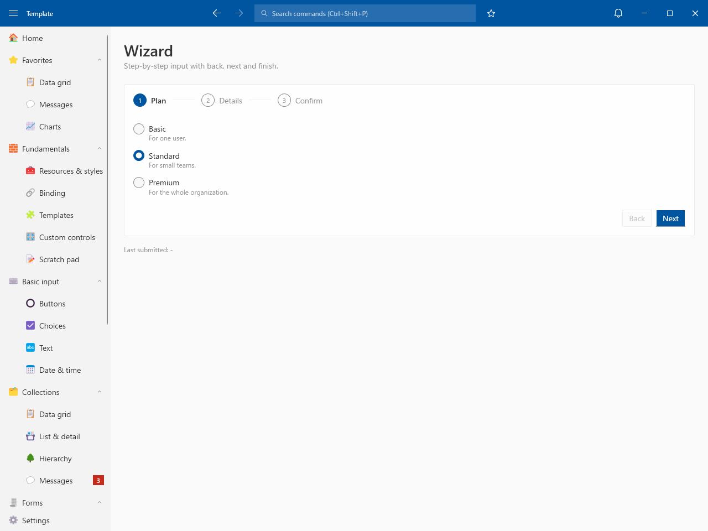
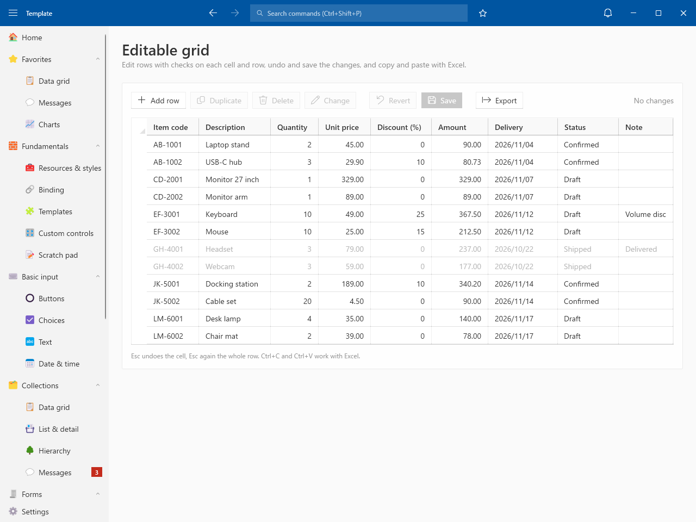
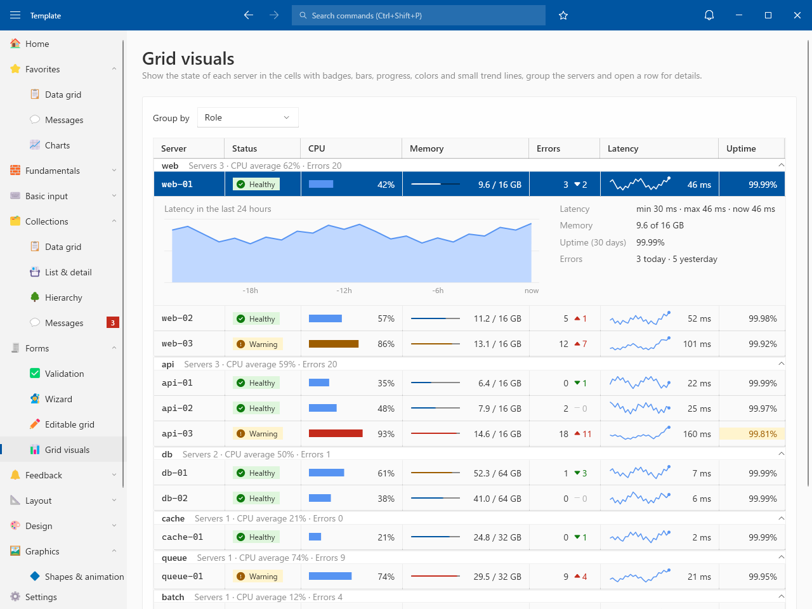

# Forms

## Validation

- Validate on lost focus / Manual validation / Focus request / Correlation (compare) / Validation rules / Form

## Wizard

- Step-by-step input with back, next and finish

## Editable grid

- Checks on each cell and row
- Add / Duplicate / Delete / Bulk change / Revert / Save to SQLite
- Copy and paste with Excel / Export to CSV

## Grid visuals

- Badges, bars, progress, colors and trend lines in cells
- Group by role or status with summaries
- Row details
