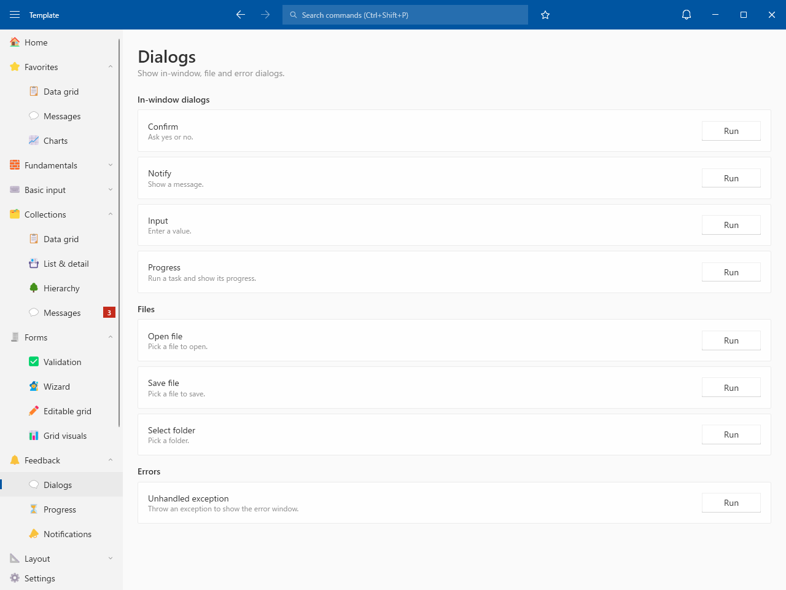
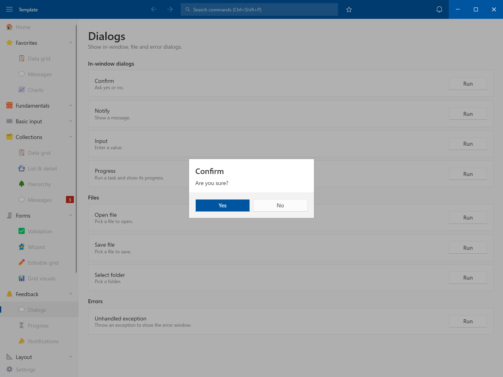
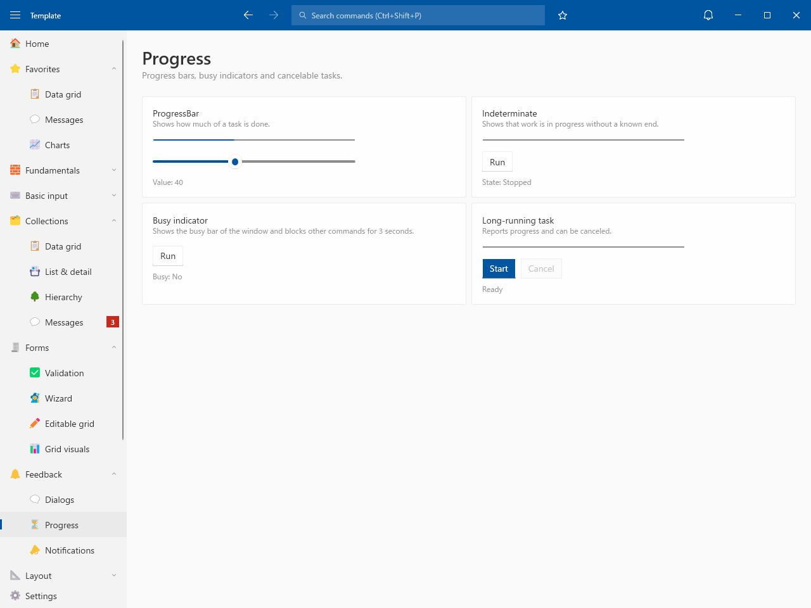
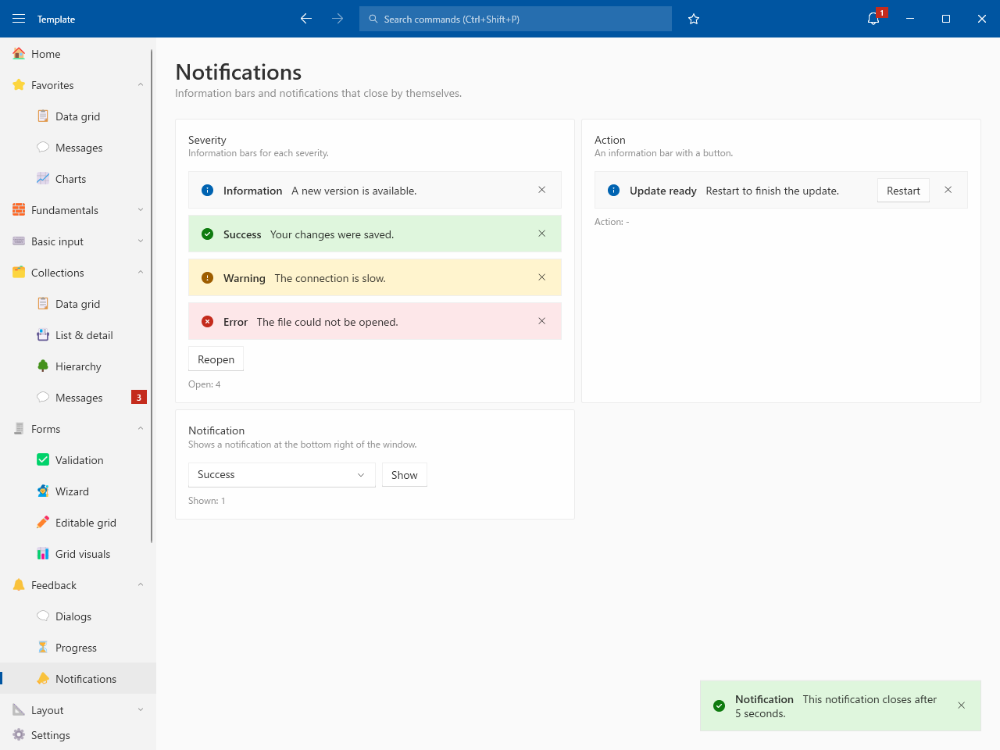

# Feedback

## Dialogs

- In-window dialogs: Confirm / Notify / Input / Progress
- File dialogs: Open file / Save file / Select folder
- Error window for unhandled exceptions

## Progress

- ProgressBar / Indeterminate / Busy indicator / Long-running task with taskbar progress

## Notifications

- Information bars for each severity / Information bar with an action
- Notifications at the bottom right of the window
