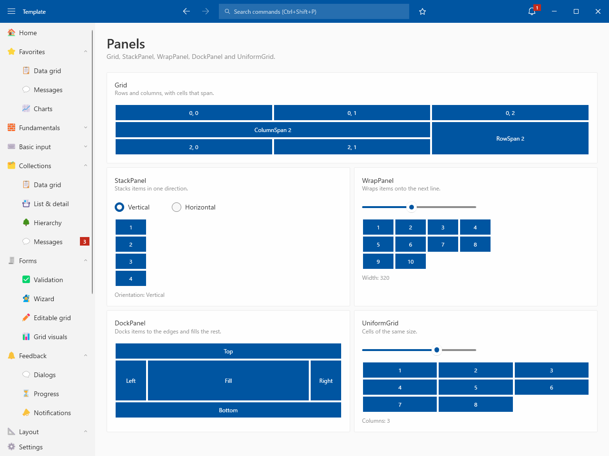
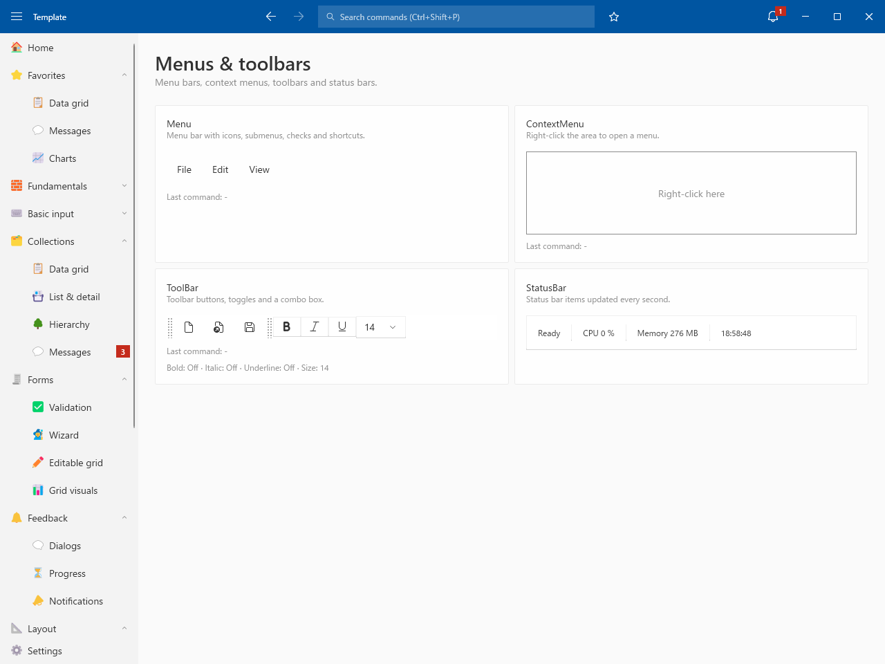

# Layout

## Panels

- Grid / StackPanel / WrapPanel / DockPanel / UniformGrid

## Containers

- Expander / GroupBox / TabControl / GridSplitter

## Menus & toolbars

- Menu / ContextMenu / ToolBar / StatusBar

## Tabs

- TabView: add, close and reorder by dragging
- Tab width modes / Close button modes
