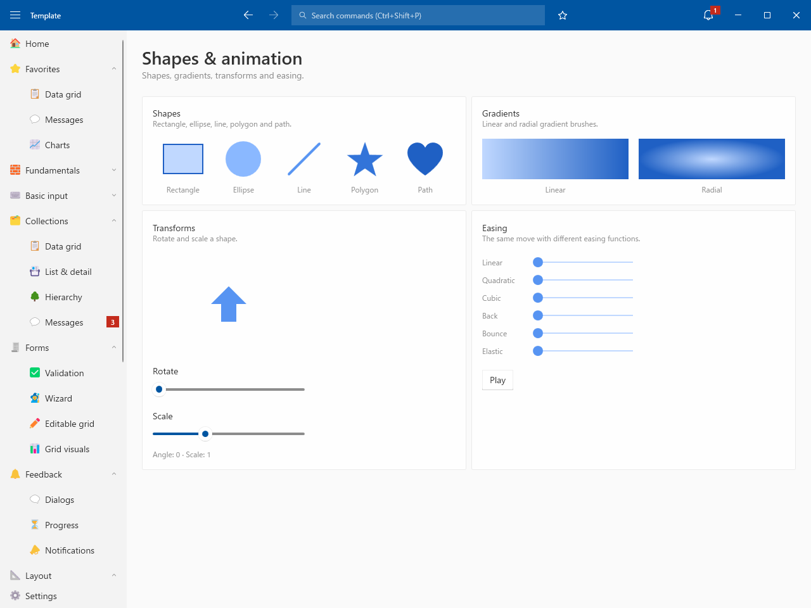
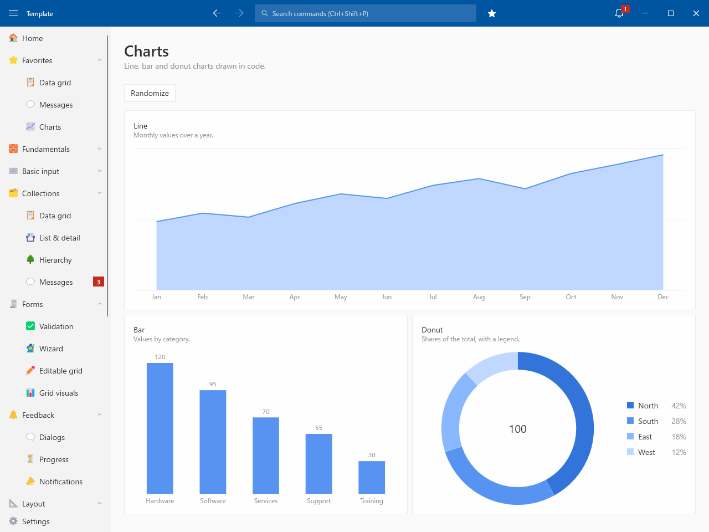
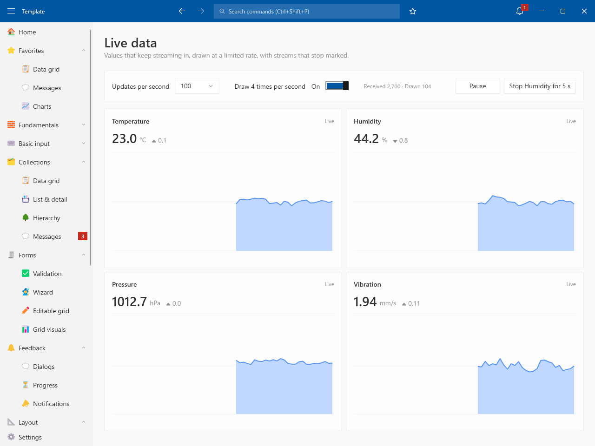

# Graphics

## Shapes & animation

- Shapes / Gradients / Transforms / Easing

## Charts

- Line / Bar / Donut charts drawn in code

## Live data

- Updates per second / Draw 4 times per second
- Streams with no data for 3 s are marked
