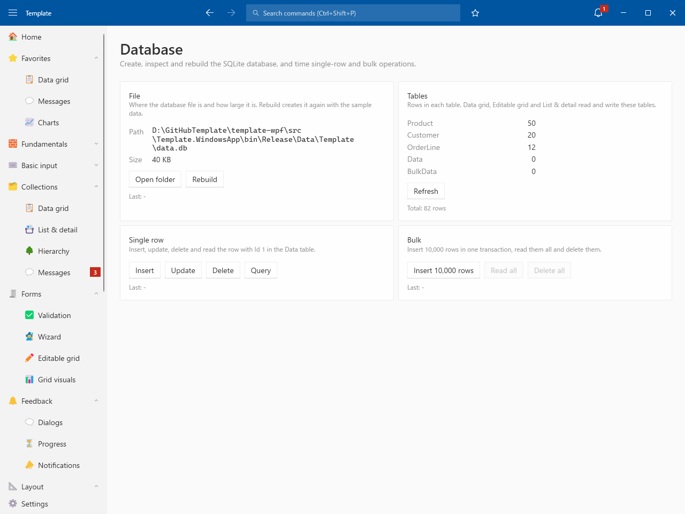
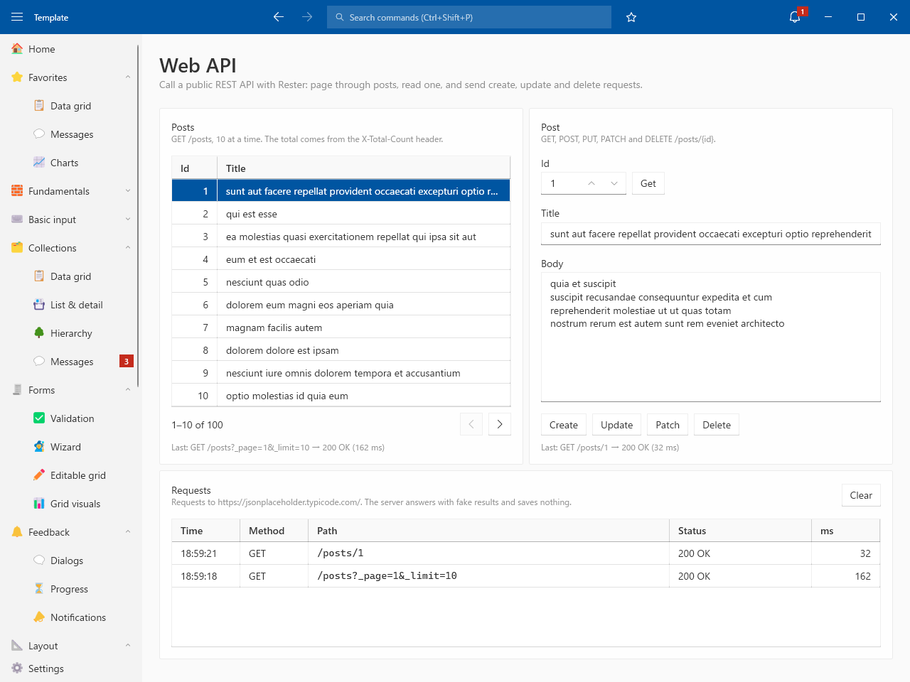

# Features

## Database

- SQLite with Smart.Data.Accessor
- File / Tables / Single row / Bulk (10,000 rows in one transaction)

## Web API

- Rester with a named HttpClient (JSONPlaceholder)
- Paging with X-Total-Count / GET / POST / PUT / PATCH / DELETE
- Request history with status and time
