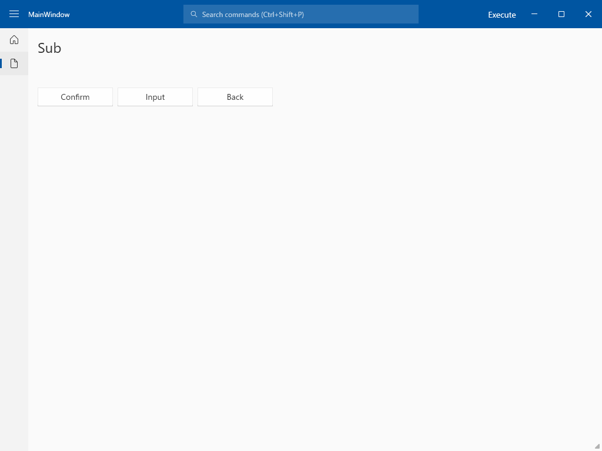
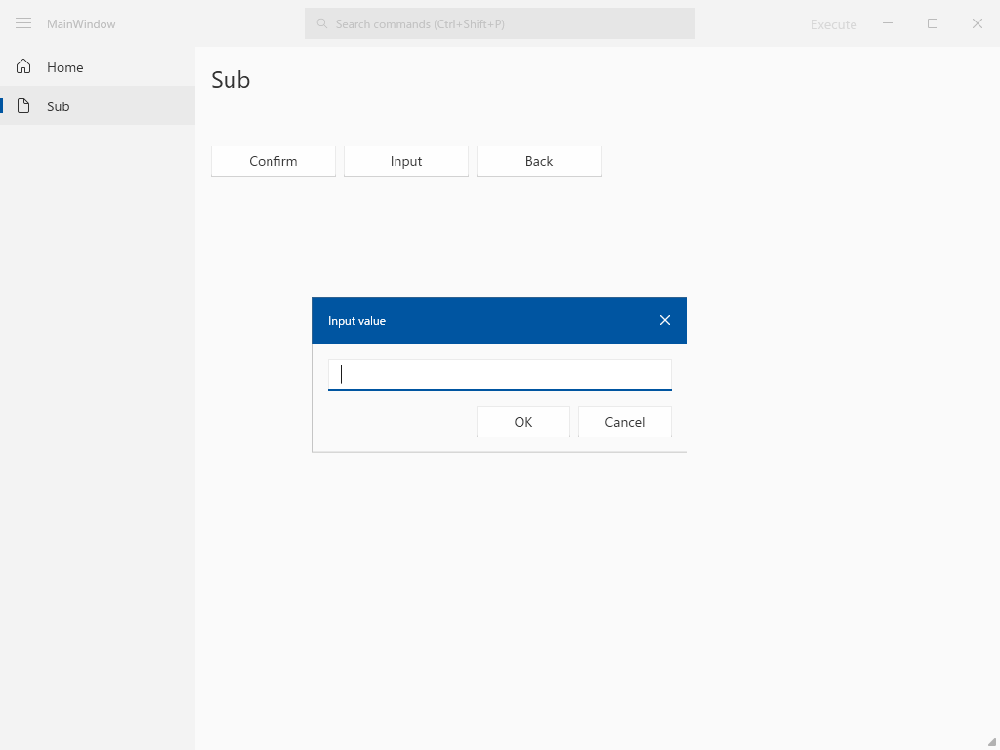

# Template project for WPF

## 📸 Image

## ✅ Implement

| Category | Feature |
| --- | --- |
| Window | Custom title bar / Snap layouts / Fluent theme / Window placement |
| Shell | Side bar / Command palette / Recent commands / Busy indicator |
| Basic | Navigation / Dialog / Setting / Logging / DI (source generator) / Leak detection |
