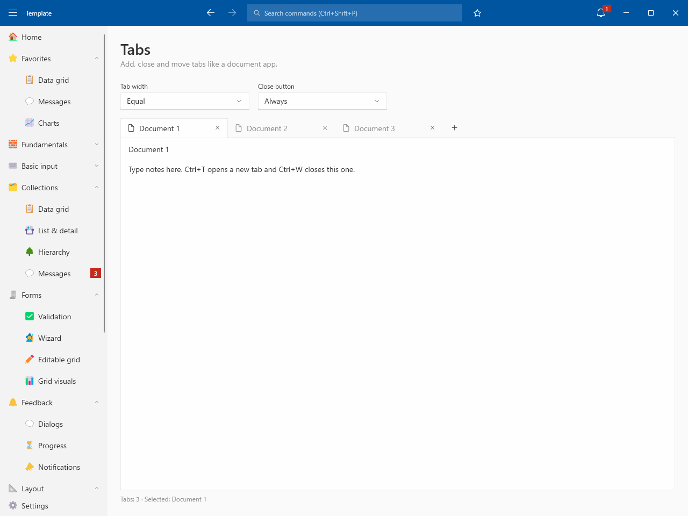
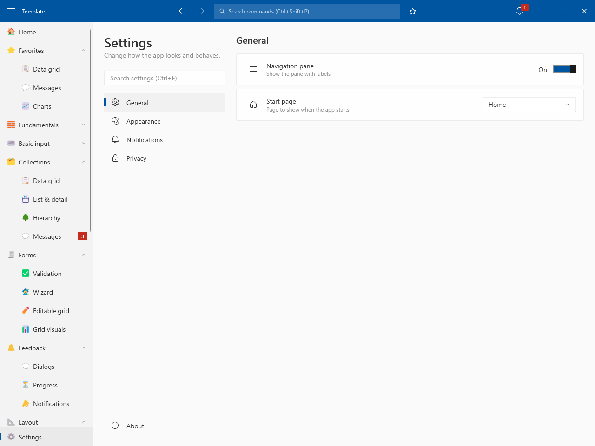
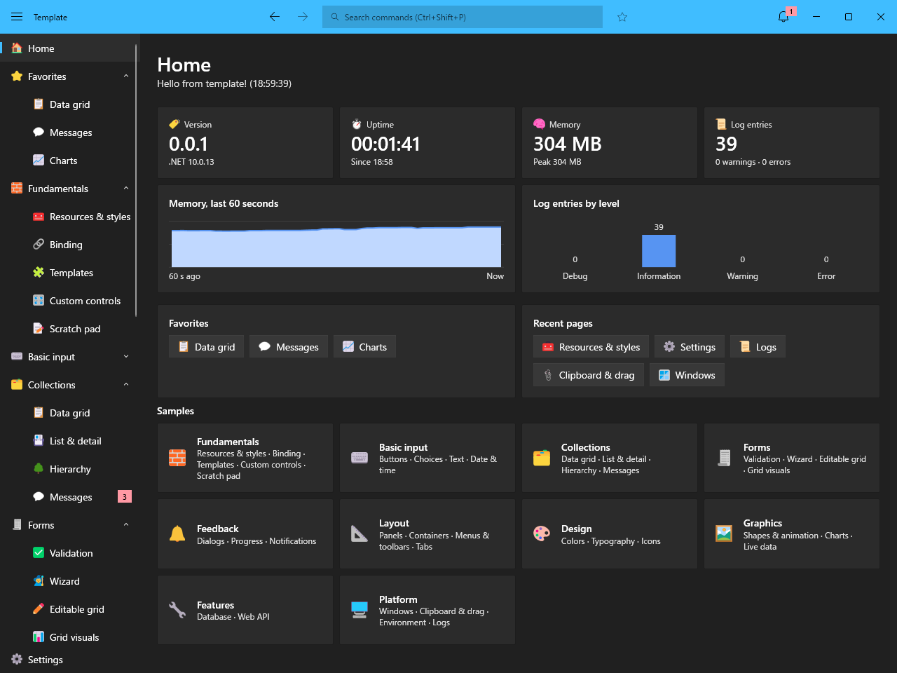

# Template project for WPF

# 📸 Image

# 📚 Example

| Group | Page |
| --- | --- |
| Fundamentals | [Example01_Fundamentals](Document/Example01_Fundamentals.md) |
| Basic input | [Example02_BasicInput](Document/Example02_BasicInput.md) |
| Collections | [Example03_Collections](Document/Example03_Collections.md) |
| Forms | [Example04_Forms](Document/Example04_Forms.md) |
| Feedback | [Example05_Feedback](Document/Example05_Feedback.md) |
| Layout | [Example06_Layout](Document/Example06_Layout.md) |
| Design | [Example07_Design](Document/Example07_Design.md) |
| Graphics | [Example08_Graphics](Document/Example08_Graphics.md) |
| Features | [Example09_Features](Document/Example09_Features.md) |
| Platform | [Example10_Platform](Document/Example10_Platform.md) |

# ✅ Implement

| Category | Feature |
| --- | --- |
| Window | Custom title bar / Snap layouts / Fluent theme (Light / Dark) / Window placement / Per-monitor DPI |
| Shell | Side bar (groups, favorites, unread counts) / Recent pages / Back and forward / Command palette / Notifications (history) / Busy indicator / Settings (search) |
| App | Single instance / Startup arguments / Error window / Update notice / Taskbar progress and badge / Jump list |
| Basic | Navigation / Dialog (in-window) / Setting / Logging / DI (source generator) / Leak detection / Color emoji / Unit tests |
| Data | SQLite |
| Network | Web API |

# 📝 Credits

Icon names and codes in Models/Sample/Icons.json are from [Segoe Fluent Icons font](https://learn.microsoft.com/windows/apps/design/iconography/segoe-fluent-icons-font) by Microsoft, licensed under [CC BY 4.0](https://creativecommons.org/licenses/by/4.0/), and converted to JSON.
