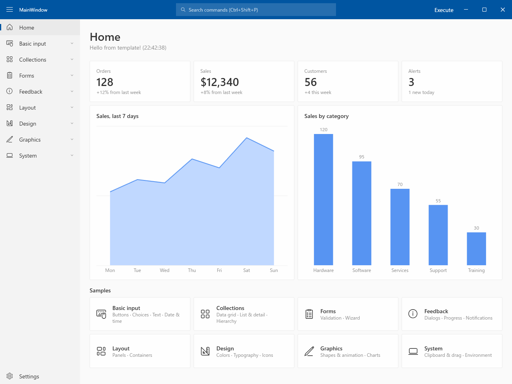
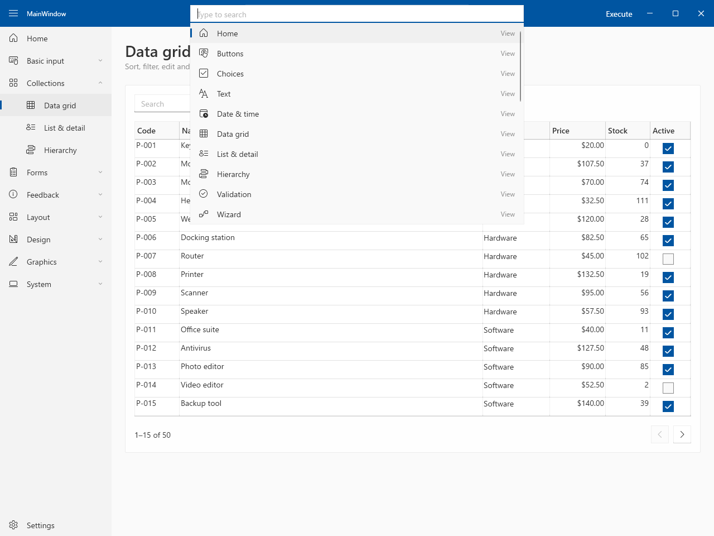
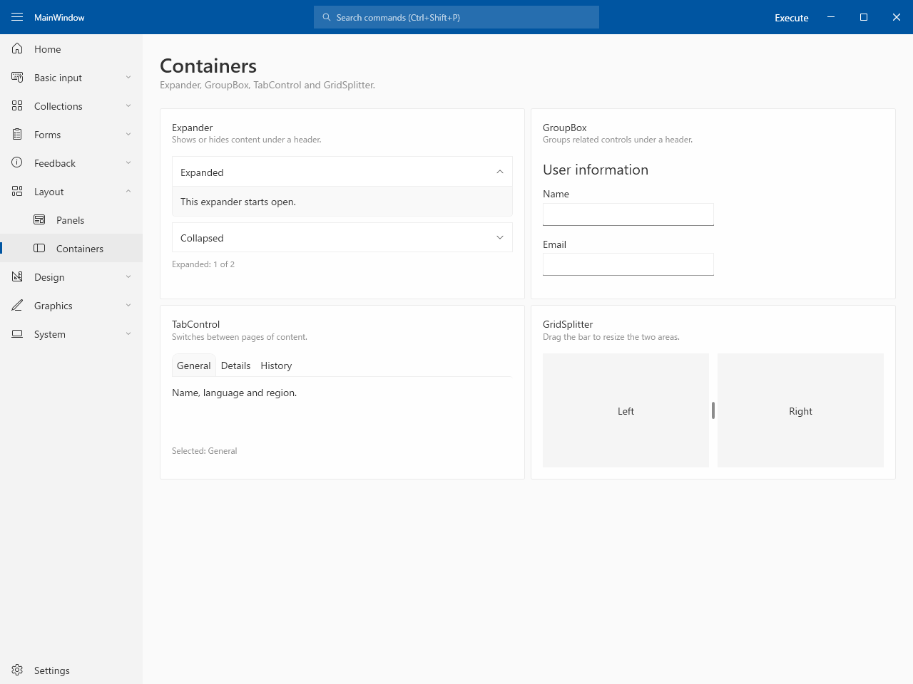
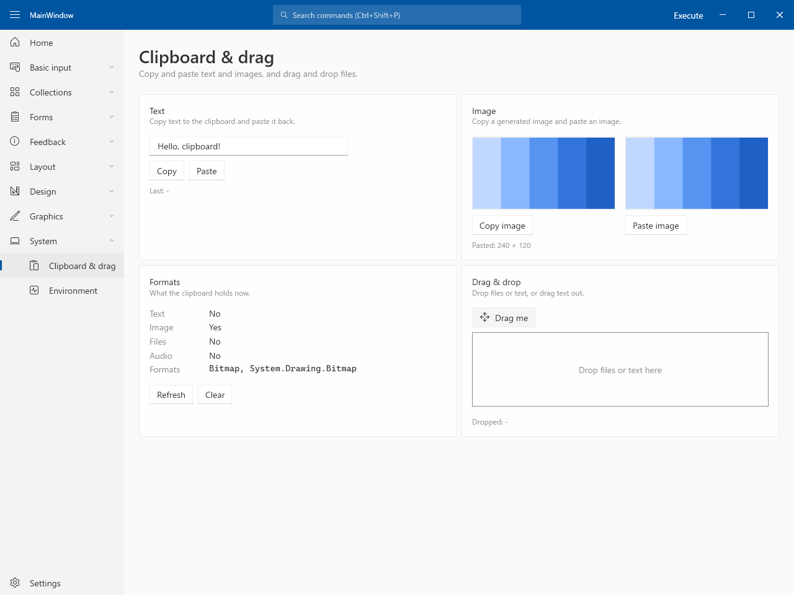

# Template project for WPF

## 📸 Image

## ✅ Implement

| Category | Feature |
| --- | --- |
| Window | Custom title bar / Snap layouts / Fluent theme (Light / Dark) / Window placement |
| Shell | Side bar (groups) / Command palette / Recent commands / Busy indicator / Notifications |
| Basic | Navigation / Dialog / Setting / Logging / DI (source generator) / Leak detection |

## 🧩 Sample

| Group | Pages |
| --- | --- |
| Basic input | Buttons / Choices / Text / Date & time |
| Collections | Data grid / List & detail / Hierarchy |
| Forms | Validation / Wizard |
| Feedback | Dialogs / Progress / Notifications |
| Layout | Panels / Containers |
| Design | Colors / Typography / Icons |
| Graphics | Shapes & animation / Charts |
| System | Clipboard & drag / Environment |

## 📝 Credits

Icon names and codes in Views/Design/Icons.json are from [Segoe Fluent Icons font](https://learn.microsoft.com/windows/apps/design/iconography/segoe-fluent-icons-font) by Microsoft, licensed under [CC BY 4.0](https://creativecommons.org/licenses/by/4.0/), and converted to JSON.
